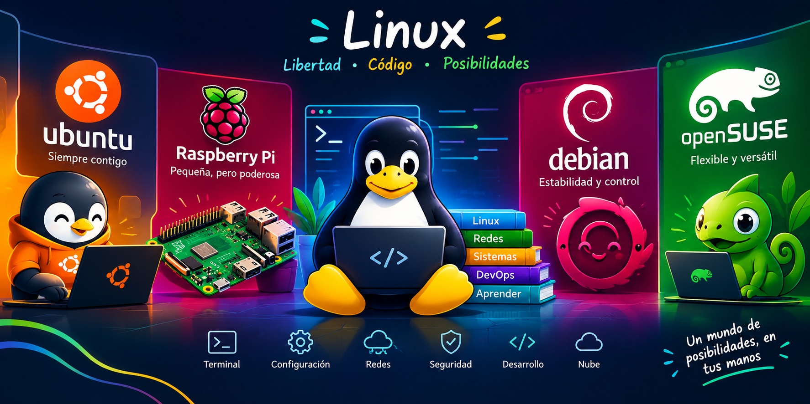

## **🛠️ Stack Tecnológico y Herramientas**
<!-- BANNER PRINCIPAL -->

  

<h1 align="center">🐧 Linux & Open Source</h1>

<h3 align="center">
  Explorando sistemas operativos, desarrollo de software y tecnologías libres
</h3>

  
  
  
  
  

### **Lenguajes de Programación**

### **Frameworks & Librerías Web**

### **Bases de Datos & ORMs**

### **Ciencia de Datos, ML & Automatización con IA**

### **DevOps, Herramientas & Entornos**

## **💼 Experiencia Laboral**

### **Desarrolladora de Software Senior / Consultora Full-Stack — Independiente / Proyectos de Software**

*Enero 2023 – Presente* | *Medellín, Colombia*

* Liderazgo en el diseño e implementación de sistemas integrales web como **ZYAFOOD** (gestión de excedentes alimentarios) y módulos **CRM (DCRM)** utilizando Django, FastAPI y PostgreSQL.  
* Arquitectura e integración de API RESTful, optimización de consultas SQL, procedimientos almacenados y triggers para garantizar un rendimiento óptimo en la gestión de datos.  
* Implementación de flujos de automatización e IA local (Ollama, n8n, agentes interactivos) para optimizar tareas operativas e integración de datos.  
* Aplicación de metodologías ágiles de ingeniería de software (SDD, TDD, BDD y ODD) para asegurar la mantenibilidad, escalabilidad y calidad del código.

  ### **Instructora y Especialista en Análisis y Desarrollo de Software — Sector Educativo / Tecnológico**

*Enero 2020 – Diciembre 2022* | *Medellín, Colombia*

* Formación y mentoría técnica a aprendices y profesionales en competencias de programación estructurada, orientada a objetos, bases de datos y arquitectura de software.  
* Elaboración de material educativo técnico y repositorios de libre acceso (`ApiRES`, `TutorialPython`, `ExportacionPDF`, `EjemploCrudPhp`) orientados a mejores prácticas de desarrollo.  
* Implementación de entornos de prueba e integración continua utilizando Git, GitHub, Docker y Postman.

  ## **🎓 Formación Académica**

  ### **Ingeniería de Sistemas**

*Universidad / Institución Educativa* | *\[Año de graduación\]*

## **🛠️ Habilidades (Skills)**

* **Habilidades Duras (Hard Skills):** Desarrollo Full-Stack (Backend & Frontend), Arquitectura de API RESTful, Modelado de Bases de Datos Relacionales y NoSQL, Integración de IA y Agentes, Gestión de Contenedores con Docker, Control de Versiones Avanzado, Análisis y Visualización de Datos.

  Lenguajes de Programación 

Frameworks & Librerías Web 

Bases de Datos 

Ciencia de Datos, IA & Automatización 

Herramientas, DevOps & Entornos 

* **Habilidades Blandas (Soft Skills):** Capacidad analítica y resolución de problemas complejos, Comunicación técnica efectiva, Liderazgo y mentoría, Adaptabilidad tecnológica, Trabajo en equipo.
  
* **Idiomas:**  
  * Español \- Nativo  
  * Inglés \- Nivel B1 / En preparación continua hacia B2

  ## **📚 Cursos, Certificaciones y Formación Continua**

* **Especialización y Capacitación en Inteligencia Artificial (Estud-IA / Google One AI)** (2025 \- 2026\)  
* **Desarrollo Web Full-Stack y Arquitectura Cloud** — *Formación Profesional Autónoma / Certificaciones Técnicas*  
* **Proficiencia en Lengua Inglesa y Comunicación Profesional** — *Super Duolingo / Programas de Inmersión*  
  📊 Estadísticas de GitHub

 

  

  

